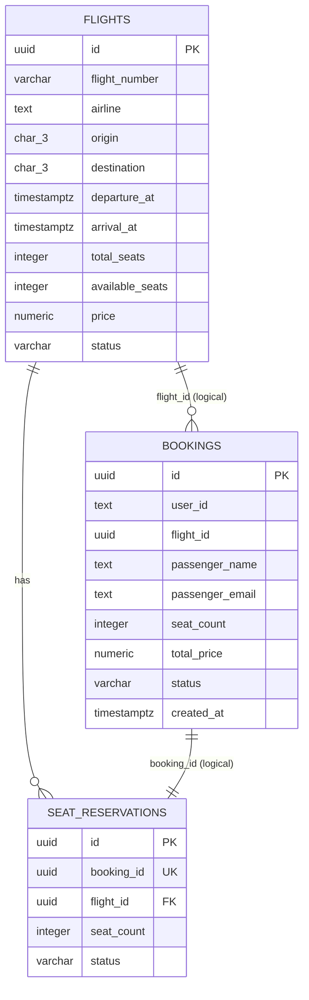

# ER-диаграмма

Базы физически разделены. `bookings.flight_id` и `seat_reservations.booking_id` связывают данные между сервисами по UUID, поэтому внешних ключей между ними нет. Каждый сервис отвечает за свою таблицу.

`FLIGHTS` и `SEAT_RESERVATIONS` находятся в БД Flight Service, `BOOKINGS` — в БД Booking Service. В каждой таблице поля зависят только от первичного ключа; повторяющихся групп и транзитивных зависимостей нет (3НФ). Цена в `bookings.total_price` — снимок стоимости покупки, а не копия текущей цены рейса. Индекс по `(flight_number, UTC-дата departure_at)` гарантирует уникальность рейса в день вылета. Проверки `CHECK` ограничивают количество мест, цену, аэропорты, время прибытия и статусы.
